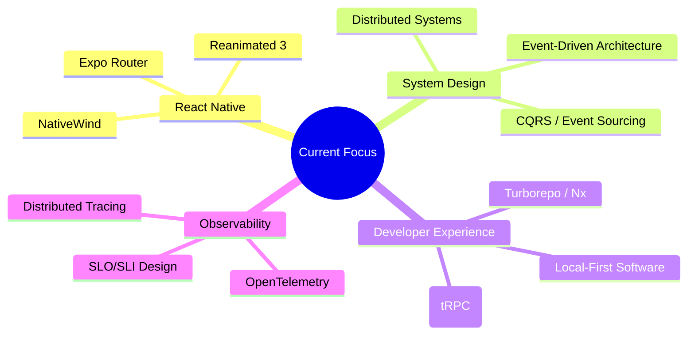

<p align="center">
  
</p>

<p align="center">
  <a href="https://github.com/rishisf12">
    
  </a>
  <a href="https://portfolio-website-rishisf13.vercel.app">
    
  </a>
  <a href="mailto:rishi@example.com">
    
  </a>
  <a href="https://linkedin.com/in/rishisf12">
    
  </a>
</p>

---

## 👨‍💻 About Me

```typescript
interface Developer {
  name: string;
  role: string;
  location: string;
  education: string;
  currentFocus: string[];
  funFact: string;
}

const rishi: Developer = {
  name: "Rishi",
  role: "Full-Stack Developer | React Native Enthusiast",
  location: "Jabalpur, India 🇮🇳",
  education: "B.Tech @ IIITDM Jabalpur",
  currentFocus: [
    "CampusPilot (Web) - Production ready campus assistant",
    "CampusPilot Mobile - React Native clone (in progress) 🚧",
    "System Design & Scalable Architectures"
  ],
  funFact: "I automate my college life so I don't have to remember my timetable! ⏰"
};
```

---

## 🛠️ Tech Stack

### **Languages & Core**


### **Frontend & Mobile**


### **Backend & Infrastructure**


### **Developer Tools**


---

## 🚀 Featured Projects

### 🎓 **CampusPilot** — *Full-Stack Campus Assistant for IIITDM Jabalpur*
> **The flagship project** — A production-grade web app solving real campus problems for 1000+ students.

| Aspect | Details |
|--------|---------|
| **Stack** | FastAPI + React 18 + PostgreSQL 16 + Docker |
| **Auth** | JWT + Passkeys (WebAuthn) + Email OTP verification |
| **Core Features** | Live schedule • Exam seat lookup (PDF parsing) • Attendance tracking • Vacant room finder • Student feedback system |
| **Observability** | Prometheus metrics • Custom telemetry pipeline • Admin monitoring dashboards • AI scan architecture (designed) |
| **Testing** | 225+ tests (SQLite + PostgreSQL) • CI with Alembic migrations |
| **Deployment** | Docker Compose profiles (default / monitoring / monitoring-full) |

**[🔗 Repository](https://github.com/rishisf12/CampusPilot)** • **[📖 Full Documentation](https://github.com/rishisf12/CampusPilot#readme)**

---

### 📱 **CampusPilot Mobile** — *React Native Clone (In Progress)*
> Building the native mobile companion — offline-first, performant, delightful.

- **Tech**: React Native (Expo) + TypeScript + React Query + AsyncStorage
- **Focus**: Offline timetable caching • Push notifications for class reminders • Biometric auth
- **Architecture**: Shared types with web backend • Optimistic UI updates • Background sync

**[🔗 Repository](https://github.com/rishisf12/CampusPilot-Mobile)** *(Private until first release)*

---

### 🌐 **Portfolio Website** — *Personal Portfolio*
> Clean, performant portfolio deployed on Vercel with CI/CD.

- **Stack**: React + Vite + Tailwind + Framer Motion
- **Features**: Dark mode • Project filtering • Responsive • SEO optimized
- **Live**: [portfolio-website-rishisf13.vercel.app](https://portfolio-website-rishisf13.vercel.app)

**[🔗 Repository](https://github.com/rishisf12/Portfolio-Website)**

---

### 💰 **pocketF** — *Personal Expense Tracker*
> Full-stack expense tracking with Docker deployment.

- **Stack**: FastAPI + React + PostgreSQL + Docker
- **Features**: Category budgets • Recurring expenses • CSV export • Charts

**[🔗 Repository](https://github.com/rishisf12/pocketF)**

---

### 🤝 **UrTeam** — *Campus Team Collaboration Platform*
> Hackathon team formation & campus activity coordination.

- **Stack**: MERN-like (MongoDB + Express + React + Node)
- **Features**: Team matching algorithm • Project showcase • Event calendar

**[🔗 Repository](https://github.com/rishisf12/UrTeam)**

---

### 🧠 **ML Learning Projects**
| Project | Description | Stack |
|---------|-------------|-------|
| [Next Word Prediction](https://github.com/rishisf12/next-word-prediction) | N-gram + Neural language model | Python, PyTorch |
| [Heart Disease Prediction](https://github.com/rishisf12/heart-disease-prediction) | Classification with ensemble methods | Python, scikit-learn |

---

## 📊 What I'm Learning / Exploring



---

## 🎯 2026 Goals

- [x] Ship CampusPilot Web to production (IIITDM deployment)
- [ ] **Release CampusPilot Mobile (React Native) to Play Store / TestFlight**
- [ ] Contribute to 3+ open source projects
- [ ] Write 6 technical blog posts
- [ ] Learn Rust basics for systems programming
- [ ] Speak at a local tech meetup

---

## 📫 Let's Connect

<p align="center">
  <a href="https://portfolio-website-rishisf13.vercel.app">
    
  </a>
  <a href="mailto:rishi@example.com">
    
  </a>
  <a href="https://linkedin.com/in/rishisf12">
    
  </a>
  <a href="https://twitter.com/rishisf12">
    
  </a>
</p>

---

<p align="center">
  
</p>

<p align="center">
  <sub>Built with ❤️ and lots of ☕ | Last updated: October 2026</sub>
</p>

<!-- 
  💡 Tip: This README is the profile README for github.com/rishisf12
  Create a repo named "rishisf12" (same as username) and push this file to main branch
  GitHub will automatically render it on your profile page!
-->